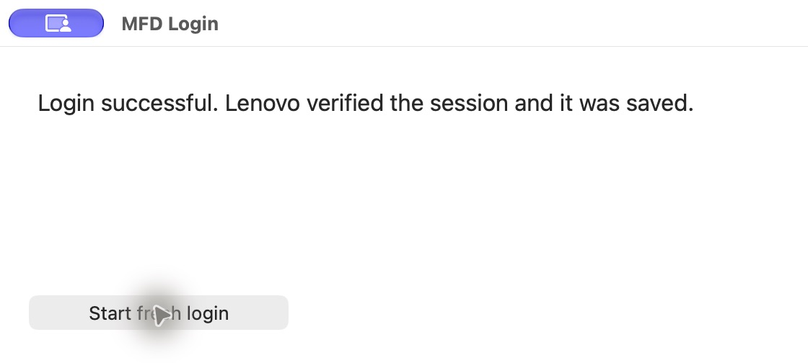

# Razr 2024 XT2453V: the exact build we unlocked

This workflow reproduces the operations used successfully on **one XT2453V** on
November 11, 2026. The new runner adds checks and guided prompts around those
operations. Its preparation and catalogue lookup were exercised locally; device
control is covered by mocked tests. The packaged runner has **not** been run
through a second hardware unlock. Compatibility is not universal or guaranteed.

Unlocking erases phone data and bootloader modification can brick the phone.
Use only a phone you own or are authorized to service. Back up your data first.
This does not install root/a custom ROM, remove a SIM lock, or perform separate
FRP removal. Expect Android setup after the factory reset.

## Exact compatibility boundary

| Property | Verified value |
|---|---|
| Phone | Motorola razr 2024, XT2453V |
| Product / chipset | aito / MediaTek MT6878 |
| Carrier package | Tracfone–Visible |
| Android / build | 16 / W1UCS36H.96-35-12-5 |
| MBM | MBM-3.1-aito-4fb16a-W1UCS36H.96-35-12-5-77c53 |
| Active slot | A |
| Before → after | oem_locked → flashing_unlocked |
| Host used | Apple Silicon Mac |
| Stock restoration | Verified on this build after the unlock |

The runner refuses different model/build/slot/image values. Do not edit the
profile hashes or remove checks to make another firmware fit. It rejects an
unrecognized archive even if a filename looks correct.

## Quick start on macOS

Install Python 3.11+, Node.js 22+ (26 was used in the recorded run), Git, Android
Platform Tools (`adb` and `fastboot`), and Xcode Command Line Tools (`xcrun swiftc`).
For example, if you already use Homebrew:

```sh
brew install python node git
brew install --cask android-platform-tools
xcode-select --install
```

Allow at least **12 GB free space** for the stock archive and generated artifacts.
Use a reliable USB cable, charge the phone to at least 50%, enable USB debugging,
and authorize this computer on the phone. Do not update the phone during this
workflow. Start with only the intended phone connected.

```sh
git clone --branch feat/xt2453v-android16-macos https://github.com/emrickk/Valhalla.git
cd Valhalla
python3 tools/razr2024/setup.py
python3 tools/razr2024/unlock.py prepare
python3 tools/razr2024/unlock.py unlock
```

`setup.py` installs pinned dependencies into the ignored `.razr-runtime/`, compiles
the native helper locally, ad-hoc signs it, and registers the `softwarefix://`
callback. It does not disable Gatekeeper or certificate verification. The helper
is not vendor-signed or notarized. Inspect source before running it.

During `prepare`, if authentication is needed:

1. The **MFD Login** app opens. Click **Start fresh login**.
2. Sign in with your Lenovo account in the default browser. Chrome worked in the
   recorded run. Allow the browser to open MFD Login if prompted.
3. Wait for **Login successful**, then press Enter in the terminal.

Do not paste credentials into GitHub or chat. The helper sends the callback token
to Lenovo for validation and stores the session in the downloader's local
owner-only `~/.mfd-cli-state.json`. It clears the temporary callback URI. The
native receiver ignores duplicates and late error callbacks after success.

The downloader requests only the exact tested package. Its SIM-count enum is
**`Dual`**, not `2`. If Lenovo no longer supplies this build, the workflow stops;
it will not silently download or flash a newer/older substitute.

### Already have the exact ZIP?

Skip Lenovo authentication and automatic download:

```sh
python3 tools/razr2024/unlock.py prepare --firmware-zip /absolute/path/to/the-stock.zip
python3 tools/razr2024/unlock.py unlock
```

Offline preparation and the Fastboot runner use Python and the bundled patcher.
On Linux, create `.razr-runtime/venv` yourself and install `capstone==5.0.9` and
`pyasn1==0.6.5` in it, then use the local-ZIP route. This Linux runner path is
untested on hardware. Windows is not supported by this new runner; the existing
Valhalla GUI is a separate workflow. Do not infer Windows support from Python alone.

## The phone confirmation matters

The runner verifies the exact target before asking you to type `ERASE AND UNLOCK`.
It flashes only `lk_a`, reboots into the patched bootloader and pauses until you
are holding the phone. Then it sends the device-specific key and opens a
**30-second** confirmation prompt:

- **Volume Down** navigates the Yes/No selection.
- **Volume Up** confirms the selected choice.
- The normal Fastboot menu's **Start** item, selected with Power, boots Android;
  it does not confirm the unlock.

If the prompt times out, the command may still return `OKAY`. The runner checks
`securestate`; it offers another attempt only while the phone remains locked.
It generates the key from **your phone's serial**, never from the recorded device.

After `flashing_unlocked` is verified, the runner restores the exact original LK,
reboots that bootloader, verifies `flashing_unlocked` again, then boots Android.
Finish the post-reset Android setup. An unlocked bootloader is not root access.

**Stock restoration is an exact-build exception:** the legacy GUI's source
contains a blanket “DO NOT flash the original LK back” warning. We successfully
restored the original LK on this specific build and rechecked the unlock state.
Do not generalize that result to other devices; their general workflow is unchanged.

## Recovery / interruption

Keep `.razr-work/` and the complete stock ZIP. It contains the original LK,
generated patched LK, receipts, and your local patch secret. Do not share it.

- If you cancel at the readiness prompt, the runner restores stock LK and leaves
  the phone in Fastboot; it does not issue an unlock command.
- If a command fails after a flash, the runner stops instead of continuing blind
  writes. If the phone is still accessible in Fastboot on the same exact build:

  ```sh
  python3 tools/razr2024/unlock.py restore-stock
  ```

  Then inspect the reported state and use the phone's Start option to boot Android.
- If the phone left Fastboot, return using its hardware buttons before retrying.
  `restore-stock` requires Fastboot and checks the same identity/hash boundary.
- If the phone no longer enumerates, stop. The presence of stock files does not
  guarantee recoverability from a hard brick; do not blindly flash unrelated
  partitions or firmware. No BROM recovery procedure has been validated here.
- Do not relock the phone as part of this workflow.

## What happened in the recorded session

1. Identified XT2453V, `aito`, Android 16 and the exact build through ADB/Fastboot.
2. Tried Fastboot readback; the device did not support `fetch`. Public downloads
   initially found were older, so none were substituted.
3. Community downloader sign-in reached Lenovo but the original Mac callback
   helper exited early. A stay-open repair received an upstream
   `oauth2 state not found` error. Reusing the success page did not fix it.
4. A downloaded alternative Mac app failed code-sign verification and was not
   executed. A locally built native callback helper then completed a fresh login
   through Chrome. Lenovo verified the session and catalogue access worked.
   The exact cause of the earlier upstream missing-state error was not proven.
5. Fixed the firmware lookup's `simCount` encoding to `Dual`; Lenovo returned the
   exact stock package. Downloaded 8,222,769,776 bytes, checked every ZIP CRC and
   verified the original LK's manifest hash and MBM version.
6. Installed Capstone and the missing `pyasn1` dependency. The bundled Val Protocol
   found the unlock flow, OEM/FRP checker, key validator and runtime serial source.
   The `unlock-serial` image passed verification for all five signed subimages.
   This verifier does not compare the root public key to hardware efuses.
7. Flashed the patch to active slot A and rebooted. The first unlock command
   returned `OKAY` after 30 seconds but the device remained `oem_locked`.
8. Reopened the prompt with the owner ready. After physical confirmation, the
   bootloader reported `Bootloader is unlocked!` and `securestate: flashing_unlocked`.
9. Restored original LK, rebooted Fastboot, independently rechecked
   `flashing_unlocked`, then rebooted Android. The owner confirmed reaching setup
   and configuring cellular service. No separate FRP erase/root/custom ROM/SIM
   unlock was performed.

## Reproducibility evidence

Stock package:

```text
AITO_G_SYS_W1UCS36H.96-35-12-5_subsidy-TRAC_VISIBLE_RSU_regulatory-DEFAULT_cid51_CFC.xml.zip
ZIP SHA-256: 3ab304685f72c5d9e6003ac33fec994cc5f68802254f36c77ae9e9a208c76e82
LK SHA-256:  9097c31de4916ffb959894369d67737fec1e98b697d44e0096ce99c1046640ff
LK manifest MD5: f8f2b1ee23a0a75bb0e97f9a2541c6d5
Valhalla source: 9535f793398082e7597bfc5063de4837ae7b471c
MFD source: b5ea93abf5bc02ee56f5f7a9601320b9d80e3396
Architecture: aarch64
Unlock flow: 0xffff0000507b275c–0xffff0000507b2f2c
OEM/FRP checker: 0xffff0000507b409c–0xffff0000507b41d4
Key validator: 0xffff0000507a2b80–0xffff0000507a2e88
Runtime serial source: 0xffff000050784af4
```

Sanitized runtime excerpts (actual operation output, identifiers omitted):

```text
Sending 'lk_a' (5496 KB) OKAY
Writing 'lk_a' OKAY
(bootloader) Bootloader is unlocked! Rebooting phone to fastboot mode
securestate: flashing_unlocked
Sending 'lk_a' (5494 KB) OKAY
Writing 'lk_a' OKAY
# After rebooting the restored stock bootloader:
securestate: flashing_unlocked
```

The firmware, patched images, phone serial/IMEI, unlock keys, login tokens, signed
download URLs and full device logs are **not published**. Hashes identify the
stock artifacts; they are not downloads. The included screenshot is an actual
capture of the native Mac login helper, not a phone screen or proof of unlocking.



## Validation and attribution

Run source-only tests without a phone:

```sh
python3 -m unittest discover -s tests -v
python3 -m py_compile tools/razr2024/*.py
```

The exact archive preparation and authenticated lookup were tested locally. Swift
source compiled on Apple Silicon. The new runner's device actions are mocked in
tests; this avoids wiping the already-unlocked phone again. These tests do not
replace another hardware validation, and no seamless/universal success claim is made.

Credits remain with Valhalla / RomLord14495, Val Protocol / Maikyxd, liblk /
R0rt1z2, and moto-firmware-downloader / JoshRob297. Setup downloads the pinned
MFD MIT-licensed source and retains its license. The original repository and
bundled components' licensing is unchanged. New files in `tools/razr2024/` and
the new Razr tests are licensed under AGPL-3.0-or-later; see the existing
[`val-protocol/LICENSE`](../val-protocol/LICENSE). This does not relicense the
original Valhalla GUI, whose upstream root does not declare a repository license.
